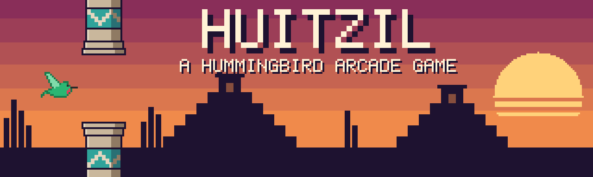

<p align="center">
  
</p>

<p align="center">
  <b>A one-button arcade game about a hummingbird darting through the carved stone
  columns of an ancient Mexica city at sunset.</b><br>
  Built from scratch with Java and LWJGL, without a game engine.
</p>

<p align="center">
  <a href="https://github.com/landoicco/huitzil/releases/latest">⬇️ Download</a> ·
  <a href="docs/GDD.md">📖 Game design</a> ·
  <a href="docs/ARCHITECTURE.md">🏗️ Architecture</a>
</p>

> *Huitzil* comes from *huitzilin*, "hummingbird" in Nahuatl.

## ▶️ Play

**[Download the latest version](https://github.com/landoicco/huitzil/releases/latest)**
and pick the file for your computer. Nothing else to install: Java comes inside
the game.

<details>
<summary>🪟 <b>Windows</b> — <code>Huitzil-windows.zip</code></summary>

1. Unzip the file and open the `Huitzil` folder.
2. Double-click **`Huitzil.exe`**.
3. The first time, Windows shows *"Windows protected your PC"*: click
   **More info → Run anyway**.

> Why the warning? Windows shows it for any app that isn't signed with a paid
> certificate. Huitzil is a free hobby project, so it isn't.

</details>

<details>
<summary>🍎 <b>macOS</b> (Apple Silicon: M1 or newer) — <code>Huitzil-macos.dmg</code></summary>

1. Open the `.dmg` and drag **Huitzil** into **Applications**.
2. Open Huitzil. macOS says it can't verify the app: click **Done**.
3. Go to **System Settings → Privacy & Security**, scroll down and click
   **Open Anyway** next to the Huitzil message, then confirm.

From then on, it opens like any other app.

> Why the warning? macOS blocks apps that aren't notarized through Apple's paid
> developer program. Huitzil is a free hobby project, so it isn't. Macs with an
> Intel processor aren't supported.

</details>

<details>
<summary>🐧 <b>Linux</b> (x86_64) — <code>Huitzil-linux.tar.gz</code></summary>

```sh
tar -xzf Huitzil-linux.tar.gz
./Huitzil/bin/Huitzil
```

</details>

## 🎮 Controls

| Key | Action |
|---|---|
| `Space` | Flap / start / restart |
| `M` | Sound on / off |
| `Esc` | Quit |
| 🖱️ Click `LICAZA.DEV` | Open my portfolio (title and game over screens) |

## ✨ Features

- 🪶 One key to play, endless columns with random gaps.
- 🏆 Score and best score, saved between sessions.
- 🎨 Original pixel art with a sunset palette and Mexica greca patterns.
- 🔊 Retro sound effects synthesized from scratch and cozy background music.
- ⏱️ Fixed-timestep game loop: the same game at any frame rate.

## 🛠️ Build from source

With [Nix](https://nixos.org), which provides the JDK, Maven and the native
libraries:

```sh
nix develop
mvn package
java -jar target/huitzil.jar
```

Without Nix, you need JDK 17+ and Maven 3.9+ on Linux, Windows or macOS (Apple
Silicon); on macOS, add `-XstartOnFirstThread` before `-jar`.

## 🙏 Credits

- 🎵 Music: [*Apple Cider*](https://opengameart.org/content/apple-cider) by
  **Zane Little Music** (CC0).

## 📄 License

Made by **Lando Icaza** — [licaza.dev](https://licaza.dev). Code and art are
released under the [MIT License](LICENSE); the music keeps its own CC0 license.
